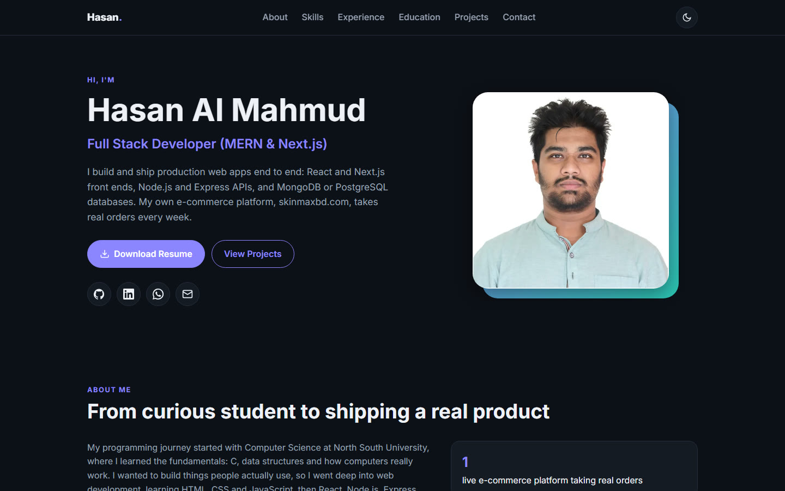

# Hasan Al Mahmud | Developer Portfolio

Personal portfolio of Hasan Al Mahmud, full stack developer (MERN and Next.js) from Dhaka.

**Live:** https://hasan-al-mahmud-dev.vercel.app



## Sections
- Responsive sticky navbar with mobile menu and light/dark mode
- Hero with designation, photo, resume download and social links
- About me, skills (graphical, grouped by Frontend / Backend / Tools), experience, education
- Projects in cards, each with a details page: stack, description, live link, client repo, challenges, future plans
- Contact: email, phone, WhatsApp

## Tech
Plain HTML, CSS and JavaScript; project content lives in `data.js`. No build step.

## Dependencies

None. The site is plain HTML, CSS and JavaScript with no build step and no npm packages; it only loads the Inter font from Google Fonts.

## Run locally
```bash
python -m http.server 5178
```
Then open http://localhost:5178.
